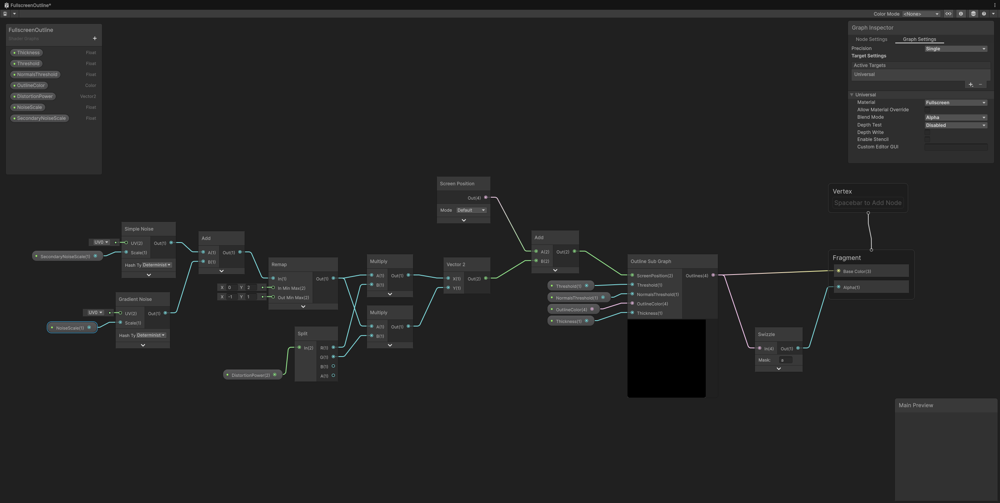
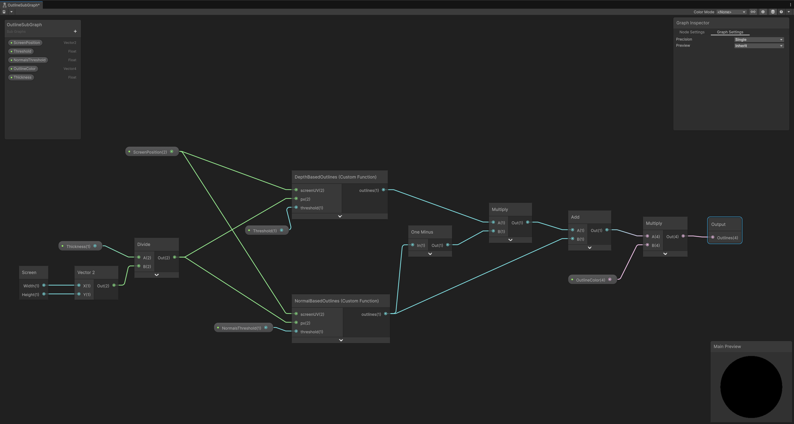

I've always been a fan of unique art styles. And in 3D games, I especially love it when it feels as if you were moving in a handpainted/handdrawn world. I think Okami is the perfect example of this, but each game has its own way, such as toon shading, outline and such. Return of the Obra Dinn also has a very unique vibe. What most of these games have in common, it's that they use postprocessing/fullscreen passes to finetune their render. And of course you also need to use models and textures that fit the vibe you're going for. So I wanted to try making some style of my own. 

The first thing I tried to do was adding a fullscreen outline. I watched and read some tutorials, and ended up using an edge detection algorithm using kernels and scharr operators. I first retrieve the normals texture, on which I apply the convolution, and then I wombine the result with a simpler edge detection algorithm for the depth texture, to fill in the potential gaps. The hlsl code is below:

```hlsl
struct ScharrOperators
{
    float3x3 x;
    float3x3 y;
};

ScharrOperators GetEdgeDetectionKernels()
{
    ScharrOperators kernels;
    kernels.x = float3x3(
        -3, -10, -3, 
         0,   0,  0, 
         3,  10,  3
    );
    kernels.y = float3x3(
         -3,  0,  3, 
        -10,  0, 10, 
         -3,  0,  3
    );
    return kernels;
}

void DepthBasedOutlines_float(float2 screenUV, float2 px, float threshold, out float outlines)
{
    outlines = 0;

#if defined(UNITY_DECLARE_DEPTH_TEXTURE_INCLUDED)

    float center = SampleSceneDepth(screenUV);

    float left  = SampleSceneDepth(screenUV - float2(px.x, 0));
    float right = SampleSceneDepth(screenUV + float2(px.x, 0));

    float down  = SampleSceneDepth(screenUV - float2(0, px.y));
    float up    = SampleSceneDepth(screenUV + float2(0, px.y));

    float dxx = left - 2.0 * center + right;
    float dyy = down - 2.0 * center + up;

    float edge = abs(dxx) + abs(dyy);

    outlines = step(threshold, edge);

#endif
}

// this uses scharr convolution with the depth texture, but results were better when using scharr with normals instead
void DepthBasedOutlinesOld_float(float2 screenUV, float2 px, float threshold, out float outlines)
{
    outlines = 0;
#if defined(UNITY_DECLARE_DEPTH_TEXTURE_INCLUDED)
    ScharrOperators kernels = GetEdgeDetectionKernels();
    float gx = 0;
    float gy = 0;
    for (int i = -1; i <= 1; i++)
    {
        for (int j = -1; j <= 1; j++)
        {
            if (i == 0 && j == 0)
                continue;
            float2 offset = float2(i, j) * px;
            float d = LinearEyeDepth(SampleSceneDepth(screenUV + offset), _ZBufferParams);
            gx += d * kernels.x[i + 1][j + 1];
            gy += d * kernels.y[i + 1][j + 1];
        }
    }
    float g = sqrt(gx * gx + gy * gy);
    outlines = g; //step(threshold, g);
#endif
}

void NormalBasedOutlines_float(float2 screenUV, float2 px, float threshold, out float outlines)
{
    outlines = 0;
#if defined(UNITY_DECLARE_NORMALS_TEXTURE_INCLUDED)
    ScharrOperators kernels = GetEdgeDetectionKernels();
    float gx = 0;
    float gy = 0;
    float3 cn = SampleSceneNormals(screenUV);
    for (int i = -1; i <= 1; i++)
    {
        for (int j = -1; j <= 1; j++)
        {
            if (i == 0 && j == 0)
                continue;
            float2 offset = float2(i, j) * px;
            float3 n = SampleSceneNormals(screenUV + offset);
            float dp = dot(cn, n);
            gx += dp * kernels.x[i + 1][j + 1];
            gy += dp * kernels.y[i + 1][j + 1];
        }
    }

    float g = sqrt(gx * gx + gy * gy);
    outlines = step(threshold, g);
#endif
}

```

This code is used as custom functions inside a shadergraph, which adds some distortion to the outlines to create the illusion of a shaky hand drawing the lines:




In a simple scene, this is the result I got after tweaking the values a bit:



This is cool, but I wanted to go a bit further by adding another effect: hatched shadows. Since I couldn't directly override the way shadows are drawn on screen, I cheated a little bit by simply applying a darker hatch pattern on top of existing shadows. 

I first needed to retrieve the shadows, using unity's API, then I had to create a hatch pattern that would not move with the camera angle, and that would be in world space instead of screen space. For this, I used the normal at the sampled point and applied some math. The code is below:

```hlsl
#ifndef SHADERGRAPH_PREVIEW

#pragma multi_compile _ _MAIN_LIGHT_SHADOWS
#pragma multi_compile _ _MAIN_LIGHT_SHADOWS_CASCADE
#pragma multi_compile_fragment _ _SHADOWS_SOFT

#endif

void GetShadow_float(float2 screenUV, out float shadow, out float3 worldPos)
{
    shadow = 0;
    worldPos = float3(0, 0, 0);
#if defined(UNITY_DECLARE_DEPTH_TEXTURE_INCLUDED)

    float depth = SampleSceneDepth(screenUV);

    worldPos = ComputeWorldSpacePosition(screenUV, depth, UNITY_MATRIX_I_VP);

    float4 shadowCoord = TransformWorldToShadowCoord(worldPos);
    
    Light mainLight = GetMainLight(shadowCoord, worldPos, 1.0);
    
    shadow = 1 - mainLight.shadowAttenuation;

#endif
}

void GetHatch_float(float3 worldPos, float3 worldNormal, float2 spacing, float2 lineWidth, float angle, out float hatch)
{
    worldNormal = normalize(worldNormal);
    
    float3 reference = float3(0, 1, 0);
    float3 tangent = reference - worldNormal * dot(reference, worldNormal);

    if (dot(tangent, tangent) < 0.001)
    {
        reference = float3(1, 0, 0);
        tangent = reference - worldNormal * dot(reference, worldNormal);
    }
    
    tangent = normalize(tangent);

    float3 bitangent = normalize(cross(worldNormal, tangent));
    
    float2 uv = float2(
        dot(worldPos, tangent),
        dot(worldPos, bitangent)
    );
    
    angle = radians(angle);
    float2 direction = float2(
        cos(angle),
        sin(angle)
    );

    float coord = dot(uv, direction);
    
    float pattern = coord / spacing;

    float dist = abs(frac(pattern + 0.5) - 0.5);

    float halfWidth = lineWidth * 0.5;

    float aa = fwidth(pattern);

    hatch = 1.0 - smoothstep(halfWidth, halfWidth + aa, dist);
}
```

Finally, I made the following shader graph:


This gives us the following effect (note that you need to tweak your shadow cascades and distance for it to work correctly with far objects):



And this is the final comparison, with both effects applied:


